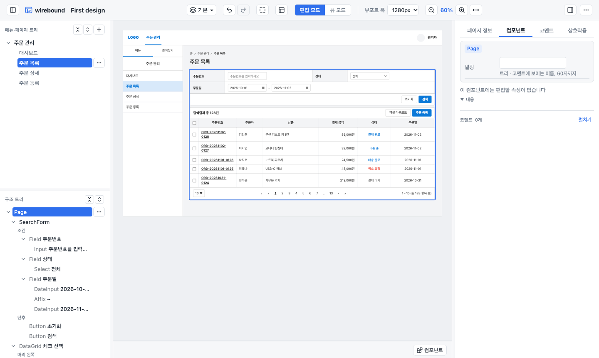

<!-- source: README.md @ v0.1.0 -->
<p align="center"><a href="README.md">English</a> | <b>한국어</b></p>

<h1 align="center">wirebound</h1>

<p align="center">웹 화면을 브라우저 에디터에서 설계하고, HTML 이나 PPTX 로 내보내고, 코딩 에이전트가 MCP 로 읽게 합니다.</p>

<p align="center">
  <a href="https://www.npmjs.com/package/@wirebound/cli"></a>
  <a href="LICENSE"></a>
</p>

<p align="center">
  
</p>

## 소개

웹 앱의 화면 설계서는 대개 슬라이드와 위키에 있어서, 개발자는 그림을 보고 화면을 다시 만들고 설계서는 코드와 어긋나 갑니다.
wirebound 는 화면마다 구조화된 데이터로 둡니다. 브라우저 에디터에서 컴포넌트 카탈로그로 화면을 짓고, 같은 데이터가 HTML 번들 · PPTX 덱 · 도구용 API 가 됩니다.
CLI(`wireb`)와 MCP 서버(`wireb-mcp`)로 개발자와 코딩 에이전트가 구현 저장소에서 설계서를 읽습니다.
도구를 직접 호스팅하고 관리자 화면 · 포털 · 마케팅 사이트 · 쇼핑몰의 설계서를 쓰는 팀을 위한 도구입니다.

## 주요 기능

- 실시간 반영과 소프트 잠금이 있는 공유 에디터에서 컴포넌트 카탈로그(폼 · 데이터 그리드 · 탭 · 팝업)로 화면을 짓습니다.
- 번호 붙은 코멘트 · 스냅샷 · 프로젝트별 역할(owner · editor · viewer)로 설계서를 검토합니다.
- 프로젝트 전체를 정적 HTML 번들이나 화면 이미지가 든 PPTX 덱으로 내보냅니다.
- `wireb` CLI 로 코드 저장소에서 설계서를 받고, 검사하고, 내보냅니다.
- 코딩 에이전트가 MCP 도구 여덟 개로 페이지를 나열하고, 읽고, 고치게 합니다.
- `wb-theme` 키트로 짓고 미리 본 테마로 모든 화면의 모양을 바꿉니다.

## 설치

요구 사항: 서버는 Compose v2 가 있는 Docker, CLI 와 MCP 서버는 Node.js 22.18 이상.

**서버.** 저장소를 받고 배포 설정 파일을 만듭니다.

```bash
git clone https://github.com/jang2162/wirebound.git
cd wirebound
cp .env.example .env
```

`.env` 를 열어 `POSTGRES_PASSWORD`(영문자와 숫자만) · `SEED_USER_EMAIL` · `SEED_USER_PASSWORD`(8자 이상)를 채우고, `SEED_USER_ADMIN=1` 줄을 더하세요.
첫 계정이 이 값으로 만들어집니다. `SEED_USER_ADMIN=1` 은 그 계정을 다른 사람을 초대하는 인스턴스 관리자로 만듭니다. 그다음 스택을 짓고 띄웁니다:

```bash
docker compose up -d --build
```

서버가 답하는지 확인합니다:

```bash
curl -s http://localhost:8080/health
```

```json
{"status":"ok"}
```

**CLI 와 MCP 서버.** 코드가 있는 기계에 설치합니다:

```bash
npm install -g @wirebound/cli @wirebound/mcp
```

설치를 확인합니다:

```bash
wireb --help
```

```text
wireb — wirebound 설계서를 리포에서 다룬다

사용법: wireb <명령> [옵션]
...
```

모든 명령은 [레퍼런스](docs/manual/ko/reference.md)에 있습니다.

## 빠른 시작

1. `http://localhost:8080` 을 열고 시딩한 계정으로 로그인한 뒤 **프로젝트 추가** 로 프로젝트를 만드세요.
   주소 창의 `/projects/` 뒤가 프로젝트 ID 입니다.

2. 코드 저장소를 프로젝트에 연결합니다:

   ```bash
   cd <YOUR_REPO>
   wireb init --server http://localhost:8080 --project <PROJECT_ID>
   wireb login --email <YOUR_EMAIL>
   wireb pull -o design.json
   ```

   `wireb login` 이 비밀번호를 묻습니다. `wireb pull` 은 설계서를 쓰고 수를 찍습니다:

   ```text
   /path/to/your-repo/design.json에 썼습니다
   메뉴 1개 · 페이지 4개
   ```

3. 코딩 에이전트에 MCP 서버를 등록합니다. Claude Code 라면 같은 저장소에서 실행하세요:

   ```bash
   claude mcp add wirebound -- wireb-mcp
   claude mcp list
   ```

   ```text
   wirebound: wireb-mcp  - ✔ Connected
   ```

> [!NOTE]
> 세션 쿠키가 `Secure` 라서 로그인은 HTTPS 나 `localhost` 에서만 됩니다.
> 다른 사람이 들어오게 하려면 서버 앞에 TLS 를 끝내는 리버스 프록시를 두세요. [Docker 로 배포하기](docs/manual/ko/how-to/deploy-with-docker.md)를 보세요.

## 문서

- [시작하기](docs/manual/ko/getting-started.md)
- [Docker 로 배포하기](docs/manual/ko/how-to/deploy-with-docker.md)
- [코드 저장소 연결하기](docs/manual/ko/how-to/connect-a-repository.md)
- [코딩 에이전트 연결하기(MCP)](docs/manual/ko/how-to/connect-a-coding-agent.md)
- [테마 만들기](docs/manual/ko/how-to/create-a-theme.md)
- [설정](docs/manual/ko/configuration.md)
- [레퍼런스](docs/manual/ko/reference.md)
- [문제 해결](docs/manual/ko/troubleshooting.md)

## 기여하기

이슈와 풀 리퀘스트를 환영합니다. 개발 환경과 돌릴 검사는 [CONTRIBUTING.md](CONTRIBUTING.md)(영어)와 [개발 안내](docs/guides/development.md)에 있습니다.
npm 릴리스는 [docs/guides/npm-release.md](docs/guides/npm-release.md)를 따릅니다.

## 라이선스

MIT 라이선스입니다. 자세한 내용은 [LICENSE](LICENSE)를 보세요.
