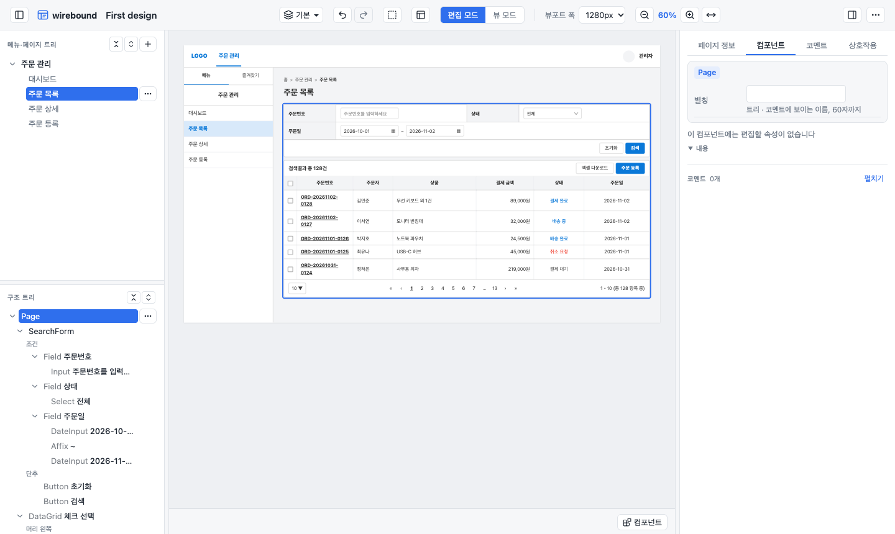

<!-- README.md (English, source) -->
<p align="center"><b>English</b> | <a href="README.ko.md">한국어</a></p>

<h1 align="center">wirebound</h1>

<p align="center">Design web screens in a browser editor, export them as HTML or PPTX, and let coding agents read them over MCP.</p>

<p align="center">
  <a href="https://www.npmjs.com/package/@wirebound/cli"></a>
  <a href="LICENSE"></a>
</p>

<p align="center">
  
</p>

## Overview

Screen specs for web apps usually live in slide decks and wiki pages, so developers rebuild every screen from pictures and the spec drifts from the code.
wirebound keeps each screen as structured data: you build it from a component catalog in a browser editor, and the same data becomes an HTML bundle, a PPTX deck, and an API for your tools.
A CLI (`wireb`) and an MCP server (`wireb-mcp`) let developers and coding agents read the spec from the implementation repository.
It is for teams that self-host their tools and write specs for admin screens, portals, marketing sites, or shops.

## Features

- Build screens from a catalog of components (forms, data grids, tabs, popups) in a shared editor with live updates and soft locks.
- Review specs with numbered comments, snapshots, and per-project roles (owner, editor, viewer).
- Export the whole project as a static HTML bundle or a PPTX deck with screen images.
- Pull, lint, and export specs from your code repository with the `wireb` CLI.
- Let coding agents list, read, and edit pages through eight MCP tools.
- Restyle every screen with themes built and previewed with the `wb-theme` kit.

## Installation

Requirements: Docker with Compose v2 for the server, Node.js 22.18 or later for the CLI and the MCP server.

**Server.** Clone the repository and create the deployment settings file.

```bash
git clone https://github.com/jang2162/wirebound.git
cd wirebound
cp .env.example .env
```

Open `.env`, fill in `POSTGRES_PASSWORD` (letters and digits only), `SEED_USER_EMAIL`, and `SEED_USER_PASSWORD` (8 characters or more), and add the line `SEED_USER_ADMIN=1`.
The first account is created from these values. `SEED_USER_ADMIN=1` makes it the instance admin, who invites everyone else. Then build and start the stack:

```bash
docker compose up -d --build
```

Verify that the server answers:

```bash
curl -s http://localhost:8080/health
```

```json
{"status":"ok"}
```

**CLI and MCP server.** Install them on the machine that holds your code:

```bash
npm install -g @wirebound/cli @wirebound/mcp
```

Verify the installation:

```bash
wireb --help
```

```text
wireb — wirebound 설계서를 리포에서 다룬다

사용법: wireb <명령> [옵션]
...
```

The CLI messages are in Korean. The [reference](docs/manual/en/reference.md) lists every command in English.

## Quick Start

1. Open `http://localhost:8080`, sign in with the seed account, and create a project with **프로젝트 추가** (Add project).
   The project ID is the part after `/projects/` in the address bar.

2. Connect your code repository to the project:

   ```bash
   cd <YOUR_REPO>
   wireb init --server http://localhost:8080 --project <PROJECT_ID>
   wireb login --email <YOUR_EMAIL>
   wireb pull -o design.json
   ```

   `wireb login` asks for your password. `wireb pull` writes the spec and prints a count:

   ```text
   /path/to/your-repo/design.json에 썼습니다
   메뉴 1개 · 페이지 4개
   ```

3. Register the MCP server with your coding agent. For Claude Code, run this in the same repository:

   ```bash
   claude mcp add wirebound -- wireb-mcp
   claude mcp list
   ```

   ```text
   wirebound: wireb-mcp  - ✔ Connected
   ```

> [!NOTE]
> Sign-in only works over HTTPS or on `localhost`, because the session cookie is `Secure`.
> To let other people in, put a TLS-terminating reverse proxy in front of the server. See [Deploy with Docker](docs/manual/en/how-to/deploy-with-docker.md).

## Documentation

- [Getting Started](docs/manual/en/getting-started.md)
- [Deploy with Docker](docs/manual/en/how-to/deploy-with-docker.md)
- [Connect a code repository](docs/manual/en/how-to/connect-a-repository.md)
- [Connect a coding agent (MCP)](docs/manual/en/how-to/connect-a-coding-agent.md)
- [Create a theme](docs/manual/en/how-to/create-a-theme.md)
- [Configuration](docs/manual/en/configuration.md)
- [Reference](docs/manual/en/reference.md)
- [Troubleshooting](docs/manual/en/troubleshooting.md)

## Contributing

Issues and pull requests are welcome. See [CONTRIBUTING.md](CONTRIBUTING.md) for the development setup and the checks to run.
Releases to npm follow [docs/guides/npm-release.md](docs/guides/npm-release.md).

## License

MIT License. See [LICENSE](LICENSE) for details.
